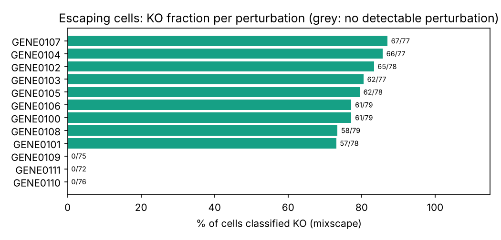
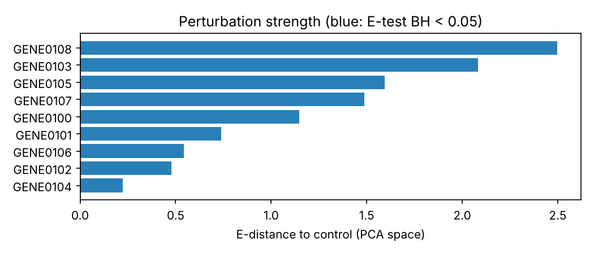
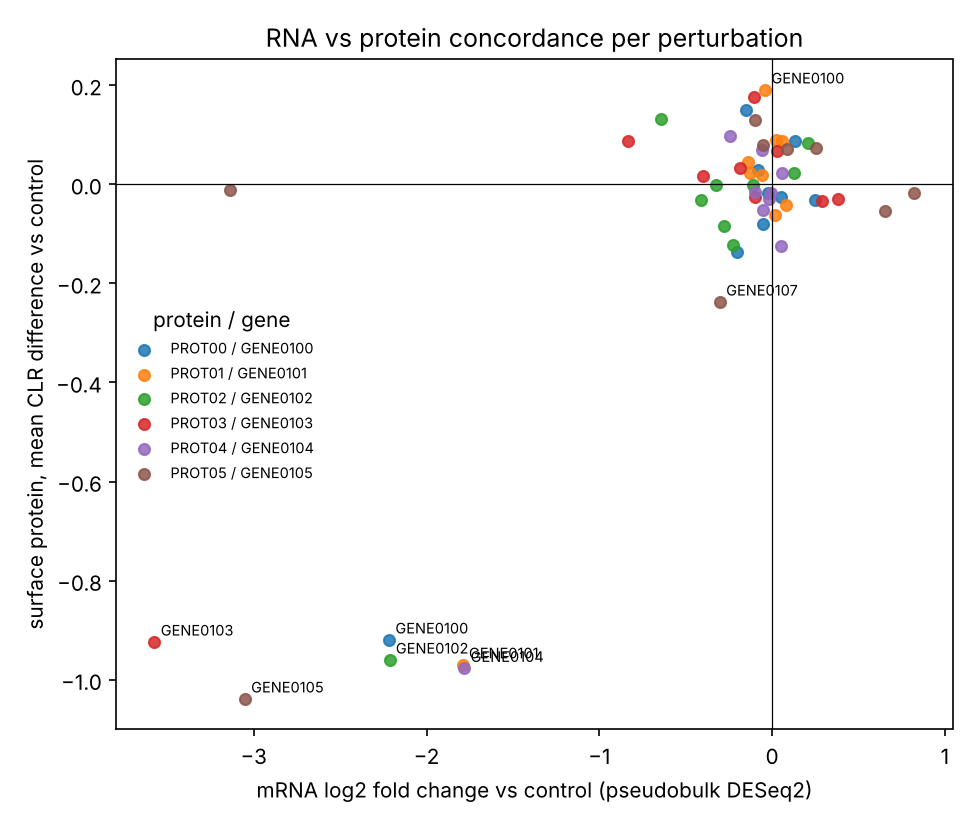
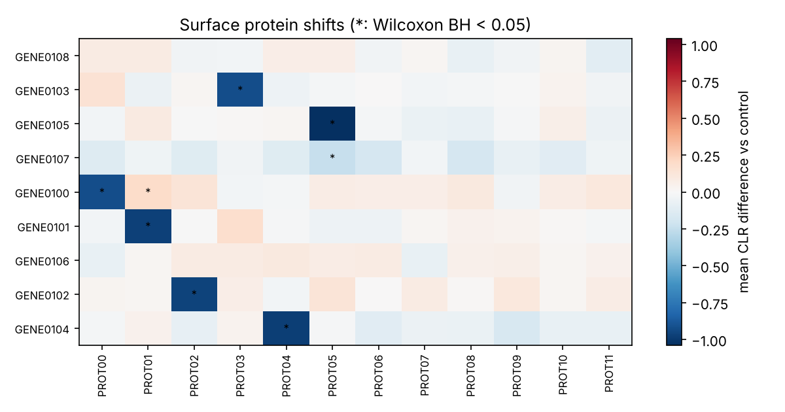

# scperturb-rna-protein-integration
Python + R pipeline for the Papalexi 2021 ECCITE-seq CRISPR screen (scPerturb): MAD-based QC, shifted-log and CLR normalisation, mixscape escaping-cell removal, E-distance perturbation strength, pseudobulk DESeq2, RNA vs surface-protein concordance, and DIABLO RNA/protein integration. Config-driven, tested, synthetic smoke data, CI.

# Multimodal analysis of a pooled CRISPR screen: ECCITE-seq RNA + surface protein

[](https://github.com/meezo1402/scperturb-rna-protein-integration/actions/workflows/ci.yml)

A reproducible pipeline for paired RNA + surface-protein single-cell perturbation data
in the scPerturb format (Peidli et al., *Nat Methods* 2024), built around the Papalexi
et al. 2021 ECCITE-seq screen of PD-L1 regulators in IFN-gamma-stimulated THP-1 cells.
Python (scanpy, PyDESeq2) for the single-cell stages, R (mixOmics) for the supervised
RNA/protein integration, one YAML config per dataset, unit tests, and a CI run on
synthetic data with planted effects so every stage can be checked for recovery.

**Why this dataset.** The screen asks which genes regulate a *protein* (PD-L1 on the cell
surface), so measuring RNA and protein in the same cells is the experiment, not an add-on:
a regulator can lower surface PD-L1 without touching *CD274* mRNA, and only the paired
readout can see that. It also has built-in positive controls (the IFN-gamma receptor /
JAK / STAT1 / IRF1 axis must reduce PD-L1 when knocked out), multiple gRNAs per target
(real replicates), and a known population of cells that carry a guide but escaped the
edit, which is the problem the mixscape method was invented on this very data to solve.
The same pipeline also runs on the much larger Frangieh et al. 2021 Perturb-CITE-seq
dataset (`config/frangieh2021_perturb_cite_seq.yaml`).

## What someone who works with this data looks for, and where it is answered

| Expectation | Stage | How |
|---|---|---|
| Non-targeting cells are the control, not "unperturbed" cells | all | the scPerturb `control` label (NT guides) is the reference everywhere |
| Guide-carrying cells that escaped the edit are removed before any estimate | 3 mixscape | perturbation signature (expression minus k = 20 nearest NT neighbours in PCA space, per replicate), then a two-Gaussian mixture per target with the non-perturbed component pinned to NT; posterior P(KO) > 0.5 keeps a cell; targets with < 5 DE genes are "no detectable perturbation" |
| Replication at the guide level, not the cell level | 5 DE | pseudobulk per target x gRNA, one DESeq2 model, Wald contrast vs control; the cell-level Wilcoxon is produced but labelled pseudoreplicated |
| An effect size per perturbation that is not a p-value or a gene count | 4 E-distance | energy distance to control in PCA space with a permutation E-test (the metric introduced with scPerturb) |
| RNA and protein read together | 5, 6 | per-target mRNA log2FC of the coding gene vs the protein's CLR shift (concordant / protein-only / mRNA-only), then DIABLO on pseudobulk samples to select the RNA and protein features that co-vary with the perturbation label |
| Positive controls recovered | results | IFNGR1, IFNGR2, JAK2, STAT1 and IRF1 knockouts should show reduced PD-L1 protein in KO cells and rank high by E-distance |
| Thresholds that are not magic numbers | 1 QC | MAD-based outlier rules per dataset; both-MADs-and-absolute rule for mito |
| Someone else can run it | all | config-driven, seeds everywhere, synthetic smoke data, tests, CI |

## Pipeline

```
RNA .h5ad  +  protein .h5ad  (shared barcodes, raw counts, obs.perturbation with "control")
          |
   [1] QC          align cells; MAD outliers (counts, genes, top-20 %, mito); Scrublet per replicate;
          |        genes in >= n cells; targets with >= n cells; multi-guide cells dropped
   [2] normalise   RNA: shifted log -> seurat_v3 HVGs -> PCA -> kNN/UMAP        protein: CLR
          |
   [3] mixscape    perturbation signature -> KO / NP per cell -> NP cells excluded downstream
          |
   [4] E-distance  effect size of every target vs control in PCA space + permutation E-test
          |
   [5] DE          pseudobulk per target x gRNA -> DESeq2 vs control (primary); cell-level Wilcoxon
          |        (secondary); protein Wilcoxon on CLR; RNA vs protein concordance per target
   [6] export      pseudobulk RNA log-CPM + protein mean CLR + labels for the strongest targets
          |
   [7] DIABLO (R)  block.splsda: ncomp by repeated CV, keepX tuned, one whole gRNA per class held out,
                   selected RNA / protein signatures, sample, variable and circos plots
```

## Quick start

```bash
git clone https://github.com/meezo1402/scperturb-rna-protein-integration.git
cd scperturb-rna-protein-integration
pip install -r requirements.txt              # or: conda env create -f environment.yml

python scripts/00_make_synthetic_data.py     # simulated RNA + protein pair with planted effects
python scripts/run_pipeline.py --config config/smoke.yaml        # ~30 s, all Python stages
Rscript scripts/06_diablo_integration.R --input results/smoke/diablo_input --out results/smoke/diablo
pytest -q                                     # unit tests
```

## Running on the Papalexi 2021 data

1. Get the RNA and protein files (two routes in `data/README.md`: the scPerturb Zenodo
   release, or `pertpy.data.papalexi_2021()` written out to h5ad).
2. Open them once and check `adata.obs.columns` and the protein `var_names`; set
   `replicate_col` (gRNA column), `batch_col` (replicate/lane) and the ADT name in
   `concordance.protein_gene_map` in `config/papalexi2021_eccite_seq.yaml`.
3. Run; the processed AnnData is written once, so later stages can be re-run alone:

```bash
python scripts/run_pipeline.py --config config/papalexi2021_eccite_seq.yaml --stages qc,normalize,mixscape
python scripts/run_pipeline.py --config config/papalexi2021_eccite_seq.yaml --stages edist,de,export
Rscript scripts/06_diablo_integration.R --input results/papalexi2021/diablo_input --out results/papalexi2021/diablo
```

What to check in `results/papalexi2021/`: `mixscape_summary.csv` (which targets have a
detectable KO population and how large), `edistance.csv` (IFN-gamma pathway targets at
the top), `de/rna_protein_concordance.csv` (PD-L1 protein down in the pathway KOs; any
"protein only" target is the interesting kind), and `diablo/diablo_selected_*.csv`.

## Example output (synthetic data)

Numbers and figures from `config/smoke.yaml` on the simulated pair: 12 targets (3 null),
20 % escaping cells in every real target, 6 proteins coupled to a target gene, 2 gRNAs per
target. They demonstrate the pipeline's behaviour against a known truth, not biology.

| Check | Result |
|---|---|
| mixscape | KO detected in 9 of 9 real targets, 0 of 3 nulls; escaping cells recovered with sensitivity 0.96 and specificity 0.99 (136/141 found, 7/561 false) |
| E-test (KO cells only) | 9 of 9 real targets at BH < 0.05; the 3 nulls had no KO cells and were dropped upstream |
| Pseudobulk DESeq2 (2 gRNAs vs 2 gRNAs) | 147 gene x target pairs at padj < 0.05 across the 9 real targets, 0 in nulls |
| Protein Wilcoxon | all 6 planted couplings at BH < 1e-20, plus 2 small cell-level false positives (effect 0.2 CLR) that the pseudoreplication caveat exists for |
| RNA vs protein | 4 of 6 couplings "concordant"; 2 "protein only" because DESeq2 lost the knocked-down gene to independent filtering at 2 vs 2 replicates, a power limit the table makes visible rather than hides |
| QC | 67 of 1,360 cells removed (35 high-mito, 31 low-complexity, 34 Scrublet doublets; some overlap) |

<p align="center">
 <br>
 
</p>

## Outputs

```
results/<dataset>/
  qc_summary.csv, qc_per_cell.csv.gz, qc_cells.png
  processed_rna.h5ad, processed_protein.h5ad    layers counts, lognorm / clr; obsm X_pca, X_umap; obs mixscape_*
  mixscape_summary.csv, mixscape_ko_fraction.png
  edistance.csv, edistance.png, umap_top_perturbations.png
  de/pseudobulk_counts.csv, de/pseudobulk_meta.csv (replicate mode recorded)
  de/de_pseudobulk_deseq2.csv                    primary DE table
  de/de_cell_level_wilcoxon.csv                  secondary, pseudoreplicated
  de/de_protein_wilcoxon.csv, de/protein_heatmap.png, de/volcano_<top>.png
  de/rna_protein_concordance.csv, de/rna_protein_concordance.png
  diablo_input/                                  RNA log-CPM, protein CLR, labels
  diablo/                                        model.rds, selected features per block and component,
                                                 perf by ncomp, tuned keepX, held-out predictions, metrics, plots
  summary.md, summary.json, pipeline.log
```

## Design notes

- **Nothing is hard-coded.** Paths, column names, thresholds and compute all live in the
  YAML config; `src/scpert/config.py` holds the defaults with a comment per line.
- **Raw counts are kept** in `layers["counts"]`; HVG selection and pseudobulk read them
  from there, never from a normalised `X`.
- **The replicate unit is explicit.** Pseudobulk metadata records whether samples are real
  replicates (gRNAs), pseudo-replicates, or random splits of either; the DE table carries
  that mode and the DIABLO script picks its hold-out strategy from it.
- **Random splits are for DIABLO only.** `splits_per_replicate` gives a sample-level method
  several samples per class; it is never used for DESeq2 inference.
- **mixscape is re-implemented, not imported**, so every step is visible: kNN-to-control
  signature, DE-gene perturbation vector, EM for a mixture whose NP component is fixed to
  the NT projection, iteration to convergence. Defaults match the Seurat implementation.
- **E-test cost is bounded** by subsampling both groups to the same size and re-indexing one
  pooled distance matrix per permutation.
- **Seeds everywhere**: synthetic data, Scrublet, PCA, UMAP, splits and permutations.

## Limitations

- mixscape assumes one dominant perturbation direction per target and that non-perturbed
  cells look like NT cells; heterogeneous or very weak effects are called NP.
- Pseudo-replicates (datasets without a gRNA column) capture sampling noise only; their
  DESeq2 p-values are anti-conservative and the output says so.
- With two gRNAs per target, DESeq2 has little power; the concordance table will label
  some real effects "protein only" or "neither". More guides or pseudo-replicate splits
  trade that power for honesty about the replicate unit.
- DIABLO runs on pseudobulk; cell-level joint embeddings (Seurat WNN, totalVI, MOFA+)
  answer a different question and are not included.
- The E-test with `max_cells_per_group = 300` loses power for very subtle perturbations.

## Repository layout

```
src/scpert/        io, qc, normalize, mixscape, edist, pseudobulk, de, export, plotting, synthetic, config
scripts/           00_make_synthetic_data.py, run_pipeline.py (--stages qc|normalize|mixscape|edist|de|export),
                   06_diablo_integration.R
config/            smoke.yaml, papalexi2021_eccite_seq.yaml, frangieh2021_perturb_cite_seq.yaml
tests/             pytest: E-distance vs brute force, E-test calibration, CLR, MAD, pseudobulk, mixture EM,
                   mixscape recovery of escaping cells, small end-to-end recovery
docs/figures/      example figures (synthetic)
.github/workflows/ ci.yml: tests + Python smoke run, then mixOmics DIABLO on the smoke export
```

## References

- Papalexi E. et al. Characterizing the molecular regulation of inhibitory immune checkpoints with multimodal single-cell screens. *Nat Genet* 2021 (ECCITE-seq data; mixscape).
- Peidli S. et al. scPerturb: harmonized single-cell perturbation data. *Nat Methods* 2024 (E-distance; data release).
- Frangieh C.J. et al. Multimodal pooled Perturb-CITE-seq screens in patient models define mechanisms of cancer immune evasion. *Nat Genet* 2021.
- Singh A. et al. DIABLO: an integrative approach for identifying key molecular drivers from multi-omics assays. *Bioinformatics* 2019. Rohart F. et al. mixOmics. *PLoS Comput Biol* 2017.
- Squair J.W. et al. Confronting false discoveries in single-cell differential expression. *Nat Commun* 2021.
- Ahlmann-Eltze C. & Huber W. Comparison of transformations for single-cell RNA-seq data. *Nat Methods* 2023.
- Germain P.-L. et al. pipeComp, a general framework for the evaluation of computational pipelines. *Genome Biol* 2020.
- Muzellec B. et al. PyDESeq2. *Bioinformatics* 2023. Wolock S.L. et al. Scrublet. *Cell Syst* 2019. Wolf F.A. et al. Scanpy. *Genome Biol* 2018.

## License

MIT. See `LICENSE`.
